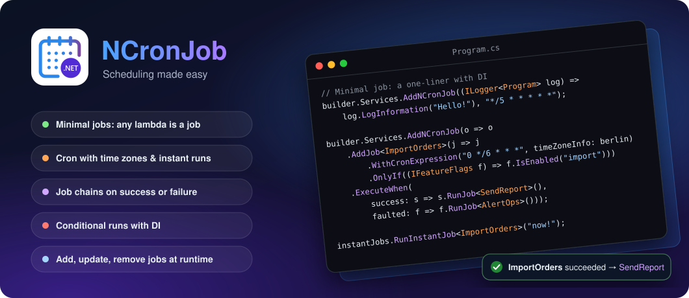

<h1 align="center">NCronJob</h1>

[](https://github.com/NCronJob-Dev/NCronJob/actions/workflows/dotnet.yml)
[](https://www.nuget.org/packages/NCronJob)
[](https://www.nuget.org/packages/NCronJob)
[](https://www.nuget.org/packages/NCronJob.Dashboard)

<p align="center">
  
</p>

# NCronJob

A Job Scheduler sitting on top of `IHostedService` in .NET.

Often, one finds oneself between the simplicity of `BackgroundService`/`IHostedService` and the complexity of
a full-blown scheduler like `Hangfire` or `Quartz`.
This library aims to fill that gap by providing a simple and easy-to-use job scheduler that can be used in any .NET
application and feels "native".

There's no need to set up a database - just schedule your tasks right away! The library provides two ways of scheduling
jobs:

1. Instant jobs - Run a job immediately (or with a small delay, or at a specific date and time).
2. Cron jobs - Schedule a job using a cron expression.

The whole documentation can be found here: [NCronJob Documentation](https://docs.ncronjob.dev/)

If you are new to the project, start with:

- [Getting Started](https://docs.ncronjob.dev/getting-started/)
- [Documentation Map](https://docs.ncronjob.dev/documentation-map/)
- [Agent & Automation Guide](https://docs.ncronjob.dev/agent-guide/)
- [`llms.txt`](https://raw.githubusercontent.com/NCronJob-Dev/NCronJob/main/docs/llms.txt) for machine-friendly discovery
- [Compact Markdown Reference](https://docs.ncronjob.dev/llms-full/)

- [Packages](#packages)
- [Features](#features)
- [Not features](#not-features)
- [Choose your starting point](#choose-your-starting-point)
- [Short example](#short-example)
- [When to call `UseNCronJobAsync`](#when-to-call-usencronjobasync)
- [Samples and detailed docs](#samples-and-detailed-docs)
- [Triggering an instant job](#triggering-an-instant-job)
- [Dashboard](#dashboard)
- [Support \& Contributing](#support--contributing)


## Packages

| Name | Description | NuGet Download Link |
|---|---|---|
| `NCronJob` | The job scheduler | [](https://www.nuget.org/packages/NCronJob) |
| `NCronJob.Dashboard` | Optional Blazor Server dashboard for ASP.NET Core apps: jobs, startup jobs, dependencies, live runs and instant triggers | [](https://www.nuget.org/packages/NCronJob.Dashboard) |

```bash
dotnet add package NCronJob
dotnet add package NCronJob.Dashboard # optional
```

## Features

- [x] The ability to schedule jobs using a cron expression.
- [x] The ability to instantly run a job.
- [x] Parameterized jobs - Instant as well as cron jobs!
- [x] Integration with ASP.NET - Access your DI container like you would in any other service.
- [x] Get notified when a job is done (either successfully or with an error).
- [x] Retries - If a job fails, it will be retried.
- [x] The job scheduler supports TimeZones. Defaults to UTC time.
- [x] Minimal API for Jobs - Implement jobs in a one-liner.
- [x] Startup jobs - Run a job when the application starts.
- [x] Define job dependencies - trigger another job if one was successful or faulted!
- [x] Add, remove, and update jobs at runtime.
- [x] Observe the progress of a job's execution.
- [x] Dashboard - See jobs, startup jobs, dependencies and live runs, and trigger jobs with a JSON parameter.

## Not features

As this is a simple scheduler, some features are not included by design. If you need these features, you might want to
look into a more advanced scheduler like `Hangfire` or `Quartz`.

- [ ] Job persistence - Jobs are not persisted between restarts of the application.
- [ ] Job history - There is no persisted history of jobs that have been run. The dashboard only keeps the last runs in memory.

## Choose your starting point

- Use the **Minimal Job API** when you want the smallest setup and delegate-based jobs
- Use **`IJob` implementations** when you want reusable job types, notification handlers, or richer orchestration
- Use **named jobs** when you need runtime management or multiple registrations of the same job type
- Use **startup jobs** when work must run during application startup

Working samples live in:

- [`sample/MinimalSample`](sample/MinimalSample)
- [`sample/NCronJobSample`](sample/NCronJobSample)
- [`sample/RunOnceSample`](sample/RunOnceSample)

For the generic-host examples below, use an ASP.NET app, a worker service, or another project that already references `Microsoft.Extensions.Hosting`.

## Short example

There are two ways to define a job.

### Minimal Job API

You can use this library in a simple one-liner:
```csharp
builder.Services.AddNCronJob((ILoggerFactory factory, TimeProvider timeProvider) =>
{
    var logger = factory.CreateLogger("My Anonymous Job");
    logger.LogInformation("Hello World - The current date and time is {Time}", timeProvider.GetLocalNow());
}, "*/5 * * * * *");

await builder.Build().RunAsync();
```

With this simple lambda, you can define a job that runs every 5 seconds. Pass in all dependencies, just like you would with a Minimal API.

### Via the `IJob` interface

1. Import the namespace (or let your IDE do the dirty work)

```csharp
using NCronJob;
```

2. Create a job

```csharp
public class PrintHelloWorld : IJob<string>
{
    private readonly ILogger<PrintHelloWorld> logger;

    public PrintHelloWorld(ILogger<PrintHelloWorld> logger)
    {
        this.logger = logger;
    }

    public Task RunAsync(IJobExecutionContext<string> context, CancellationToken token)
    {
        logger.LogInformation("Hello World");
        logger.LogInformation("Parameter: {Parameter}", context.Parameter);

        return Task.CompletedTask;
    }
}
```

3. Register the NCronJob and the job in your `Program.cs`

```csharp
builder.Services.AddNCronJob(options =>
    options.AddJob<PrintHelloWorld>(j => 
    {
        // Every minute and optional parameter
        j.WithCronExpression("* * * * *")
         .WithParameter("Hello World")
         .WithTimeout(TimeSpan.FromMinutes(2))
         .WithJobRunExpiry(TimeSpan.FromMinutes(5));
    }));
```

Scheduler-wide concurrency and queued-run expiry can be configured on the outer builder. By default, concurrency is
`Environment.ProcessorCount * 4`, job execution has no timeout, and queued runs expire after ten minutes.
`Timeout.InfiniteTimeSpan` disables either timeout or expiry.

```csharp
builder.Services.AddNCronJob(options => options
    .WithMaxDegreeOfParallelism(16)
    .WithDefaultJobRunExpiry(TimeSpan.FromMinutes(15))
    .AddJob<PrintHelloWorld>());
```

4. Run your application and see the magic happen!

## When to call `UseNCronJobAsync`

Call `UseNCronJobAsync()` or `UseNCronJob()` when you register startup jobs via `RunAtStartup(...)`.

```csharp
using Microsoft.Extensions.Logging;
using NCronJob;

var builder = Microsoft.AspNetCore.Builder.WebApplication.CreateBuilder(args);

builder.Services.AddNCronJob(options =>
{
    options.AddJob<MyJob>(j => j.RunAtStartup());
});

var app = builder.Build();
await app.UseNCronJobAsync();
await app.RunAsync();

public sealed class MyJob(ILogger<MyJob> logger) : NCronJob.IJob
{
    public Task RunAsync(NCronJob.IJobExecutionContext context, CancellationToken token)
    {
        logger.LogInformation("Startup job executed.");
        return Task.CompletedTask;
    }
}
```

Regular recurring jobs and instant jobs do not require this call.

## Samples and detailed docs

Detailed feature docs:

- [Getting Started](https://docs.ncronjob.dev/getting-started/)
- [Define and Schedule Jobs](https://docs.ncronjob.dev/features/define-and-schedule-jobs/)
- [Triggering instant jobs](https://docs.ncronjob.dev/features/instant-jobs/)
- [Model Dependencies](https://docs.ncronjob.dev/features/model-dependencies/)
- [Dynamic Job Control](https://docs.ncronjob.dev/advanced/dynamic-job-control/)
- [Known gotchas](https://docs.ncronjob.dev/advanced/known-gotchas/)
- [Dashboard](https://docs.ncronjob.dev/features/dashboard/)

Sample applications:

- [`sample/MinimalSample`](sample/MinimalSample)
- [`sample/NCronJobSample`](sample/NCronJobSample)
- [`sample/RunOnceSample`](sample/RunOnceSample)

## Triggering an instant job

If the need arises and you want to trigger a job instantly, you can do so:

```csharp
public class MyService
{
  private readonly IInstantJobRegistry jobRegistry;
  
  public MyService(IInstantJobRegistry jobRegistry) => this.jobRegistry = jobRegistry;

  public void MyMethod() => jobRegistry.RunInstantJob<MyJob>("I am an optional parameter");
    
  // Alternatively, you can also run an anonymous job
  public void MyOtherMethod() => jobRegistry.RunInstantJob((MyOtherService service) => service.Do());
}
```

## Dashboard

The optional `NCronJob.Dashboard` package serves a Blazor Server dashboard from your ASP.NET Core app:

```csharp
builder.Services.AddNCronJob(/* your jobs */);
builder.Services.AddNCronJobDashboard();

var app = builder.Build();
app.MapNCronJobDashboard("/ncronjob", endpoints => endpoints.RequireAuthorization("Admin"));
```

It shows every registered job and its next run, startup jobs and their state, the dependency graph, and live and recent runs with their parameters. From the dashboard you can enable or disable jobs and trigger instant jobs with a JSON parameter. Run [`sample/NCronJobSample`](sample/NCronJobSample) and open `/ncronjob` to try it. See [Dashboard](https://docs.ncronjob.dev/features/dashboard/) for details.

## Support & Contributing

Thanks to all [contributors](https://github.com/NCronJob-Dev/NCronJob/graphs/contributors) and people who are creating
bug reports and valuable input:

<a href="https://github.com/NCronJob-Dev/NCronJob/graphs/contributors">
  
</a>

If you have any questions or suggestions, feel free to open a new issue or pull request.
Do you want to contribute? Great! We have a predefined codespace for you to get started right away! With that you don't need any local setup and can start right away!
Either coding or updating the documentation - everything is set and done for you!

[](https://codespaces.new/NCronJob-Dev/NCronJob?quickstart=1)
